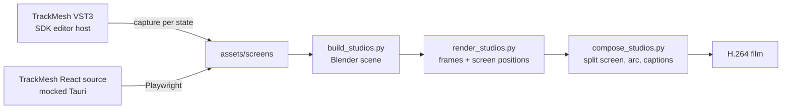

# TrackMesh — a product film built from code

A 30-second product film for [TrackMesh](https://github.com/ege-ozel/track-mesh), a Windows app that sends Ableton Live and FL Studio projects directly between collaborators' PCs. Every part of the film comes from scripts: Blender scenes, lighting, cameras, the screens inside the scene, captions, the split-screen edit and the final encode. There is no hand-made keyframe and no stock footage.

<!-- docs/media/storyboard.png: the studios-v04 storyboard (needs a .gitignore exception for docs/media/) -->

## What is interesting here

- **The whole film is code.** `scripts/build_studios.py` builds two studios in Blender 5.2 running headless: a warm room with walnut and felt, and a cool night loft with a city window. It also builds the materials, the light from the monitors, the depth of field and the camera moves, and saves a new numbered `.blend` every run. Render, edit and encode are separate scripts, and a render can stop and resume where it left off.
- **The screens show the real software.**
  - The plugin is the actual compiled TrackMesh VST3, loaded in Steinberg's SDK editor host. A local Named Pipe stands in for the TrackMesh agent and sends the same status text the real agent sends. The view is captured once per state.
  - The desktop screens come from the app's current React source. Only the Tauri bridge is replaced with a mock, and Playwright captures each state.
  - All status is synthetic. Every frame carries a "Concept visualization" mark, and nothing was really shared or transferred.
- **Two rooms that never meet.** The studios stand 40 m apart in one scene. In the link shots, each half of the split screen is rendered from its own camera. The render script projects each monitor's position into its half, and the edit draws the connecting arc between those two points.
- **Checked as it goes.** Audit scripts check camera paths, label visibility and screen framing frame by frame. The logs record render times and every capture.

## Pipeline



## Repository

| Path | What it holds |
| --- | --- |
| `scripts/build_*.py` | Scene builders: hero still, animatic, film, two studios |
| `scripts/render_*.py`, `compose_studios.py`, `encode_animatic.py` | Rendering, editing and encoding |
| `scripts/capture_*` | Plugin and desktop screen captures |
| `scripts/audit_*`, `verify_*` | Frame-by-frame checks |
| `demo-ui*/` | Builds of the TrackMesh desktop source with a synthetic status mock |
| `docs/` | Reports for each round and the creative brief |
| `logs/` | Render timings, capture records, check results |

Images, renders, video and `.blend` files are not in git; the scripts rebuild them.

## Running it

Windows only. Needs:
- Blender 5.2.2 portable in `tools/blender/`
- Python 3.12 with Pillow and pywin32
- Node 22 with Playwright
- A TrackMesh checkout with the VST3 built, plus the Steinberg SDK editor host in `tools/vst3-editorhost/`

```powershell
python scripts/capture_vst3_phases.py                 # plugin screens
node scripts/build_demo_ui_v4.mjs; node scripts/capture_demo_ui_v4.cjs   # desktop screens
tools\blender\blender-5.2.2-windows-x64\blender.exe --background --factory-startup --python scripts\build_studios.py
tools\blender\blender-5.2.2-windows-x64\blender.exe --background scenes\versions\trackmesh-studios-v04.blend --python scripts\render_studios.py
python scripts/compose_studios.py studios-v04 --percent 100 --sequence
```

## Status

Storyboard v04 is the latest preview; no final render yet. TrackMesh has changed a lot since then, so the final film will be cut again from fresh captures once the app settles.

## How it was made

Directed by Ege Özel and built with AI coding agents (Claude Code and Codex) that drove Blender through Python. Every scene, capture and edit decision is in the scripts and the reports in `docs/`.
